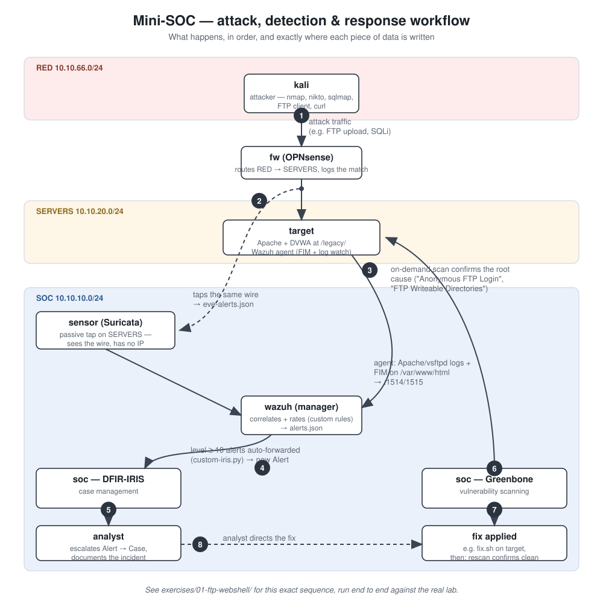

# Mini-SOC – Blue Team & Red Team Platform

A small but complete Security Operations Center (SOC) built only from free,
open-source tools. It runs as virtual machines on one computer and sets itself
up with a single command.

Final project (Abschlussprojekt) · ICT Warrior Academy · Felix Rechsteiner

**New here? [`docs/TUTORIAL.md`](docs/TUTORIAL.md) is a single zero-to-everything
walkthrough: what this is, building it, your first attack by hand, and
watching it get caught.** Everything below is the full reference.

## What's inside

| VM | Tool | Job |
|---|---|---|
| `fw` | OPNsense | Firewall between the three lab networks |
| `wazuh` | Wazuh | SIEM: collects logs and alerts, correlates, raises alarms |
| `soc` | Greenbone CE + DFIR-IRIS | Vulnerability scanning · alert and case management |
| `sensor` | Suricata | Network IDS, listens silently on the server network |
| `target` | Ubuntu + Apache, disguised as a normal site, hand-written vulnerable portal hidden underneath | Practice server (the victim) |
| `kali` | Kali Linux | Attacker for red team exercises - CLI tools by default, or a full desktop + Burp Suite with `KALI_GUI=true` in `lab.conf` |

Serious Wazuh alerts (level 10+) automatically become alerts in DFIR-IRIS, with
the attacker IP and the affected machine already filled in.

```
   SOC 10.10.10.0/24          SERVERS 10.10.20.0/24        RED 10.10.66.0/24
   wazuh, soc, sensor   <-->        target          <-->        kali
                 \________________ fw (OPNsense) __________________/
```

The full attack → detection → response workflow, step by step, with exactly
where each piece of data gets written along the way:



(source: [`docs/gen-diagram.py`](docs/gen-diagram.py) – re-run it after
changing the workflow it describes)

## Network isolation & safety

The lab is designed so that nothing inside it can reach your real network,
and the only way *in* is from your own computer:

- **Every VM has two network adapters.** NIC 1 is VirtualBox **NAT** – it
  only exists so Vagrant can SSH in and so the VMs can download packages
  during setup. NIC 2 (and NIC 3 on `sensor`) is a VirtualBox **"intnet"** –
  a fully isolated virtual switch that only exists between the lab's own
  VMs and never touches your host's physical network adapter at all. All
  the actual attack traffic (Kali → target, etc.) travels over intnet only.
- **NAT isolates outward, not sideways.** VirtualBox NAT works like a mini
  router: a VM can reach the real internet through it (needed for `apt
  install`, Docker pulls, `suricata-update`, etc.), but it has zero
  visibility onto other devices on your actual LAN/WiFi – it's hidden
  behind a private `10.0.2.0/24` subnet, not bridged onto your network.
  There is no bridged adapter anywhere in this project (the networking mode
  that *would* put a VM directly on your WiFi) – only NAT and intnet.
- **The web UIs you reach from your browser are localhost-only.** Every
  `forwarded_port` in the `Vagrantfile` (OPNsense :8443, Wazuh :8444,
  DFIR-IRIS :8445, Greenbone :9392) is explicitly bound to `host_ip:
  "127.0.0.1"`. That means only processes running on your own machine can
  reach them – not other devices on your WiFi, not anything "outside". It's
  the same mechanism as a local dev server: it looks like it's "exposed"
  because your own browser can reach it, but nothing external can.
- **Kali doesn't need internet for the exercises.** Ongoing internet access
  on `kali` (and the other VMs) is only used for package installation at
  build/update time. Every attack in `exercises/` and the red team walkthrough
  runs entirely over the isolated intnet networks.
- **What this setup does *not* protect against:** a vulnerability in
  VirtualBox itself (a hypervisor escape). That's a different class of risk
  from network exposure – unrelated to how this lab is wired – and the
  mitigation is keeping VirtualBox itself up to date, not VM networking
  changes.
- **Locking it down further:** if you want `kali` to have zero outbound
  internet access even during idle time, cut NIC 1 once the lab is built
  with `VBoxManage controlvm minisoc-kali setlinkstate1 off` (or unplug NIC
  1 in VirtualBox Manager). It'll still reach `target` fine for exercises;
  you'd just need to plug NIC 1 back in for `apt update`/`apt install`.

## Requirements

- Linux host with **VirtualBox 7** (Vagrant is installed automatically if missing)
- about **20 GB RAM** free for the full lab (less if you disable VMs in `lab.conf`)
- about **60 GB** disk space and a decent internet connection for the first build

## Quick start

```bash
git clone git@gitlab.ictwarrioracademy.ch:f.rechsteiner/minisoc-project.git
cd minisoc-project
./setup.sh
```

A clean build of the four core VMs (fw, wazuh, soc, sensor) took 26 minutes on
a laptop (i7-10510U, 32 GB RAM); target and kali add a few more minutes each.
Expect longer with a slow internet connection. At the
end it prints where to log in; the same overview is saved in `.lab/ACCESS.txt`
together with the generated lab password. Greenbone keeps loading its
vulnerability feed for another 30–60 minutes in the background.

| Tool | Address | User | New here? |
|---|---|---|---|
| OPNsense | https://localhost:8443 | root | [navigation guide](docs/guides/opnsense.md) |
| Wazuh | https://localhost:8444 | admin | [navigation guide](docs/guides/wazuh.md) |
| DFIR-IRIS | https://localhost:8445 | administrator | [navigation guide](docs/guides/dfir-iris.md) |
| Greenbone | https://localhost:9392 | admin | [navigation guide](docs/guides/greenbone.md) |
| `target` (the practice server) | http://localhost:8446/ | — | see "Red team exercise" below |

The lab uses self-signed certificates, so your browser will show a warning on
the first four. `target` is plain `http://` and deliberately looks like a
normal small company site at first glance – no login prompt, no obvious
"this is a training app" tell. That's intentional; see below for what it
actually is and how to find out.
Each guide covers where the useful stuff actually is, what to filter/search
for in this specific lab, and what the guided exercises look like in
that particular tool.

## Everyday use

```bash
./setup.sh status     # what is running + login overview
./setup.sh stop       # shut everything down (keeps the VMs)
./setup.sh            # start again / continue an interrupted build
./setup.sh destroy    # delete all VMs
vagrant ssh wazuh     # shell on a VM
```

`vagrant ssh <vm>` needs no password (it uses the key Vagrant generated for
that VM automatically). There is no other way in: `base.sh` locks the
`vagrant` account's password and turns off SSH password auth lab-wide on
every Linux VM, so the `vagrant`/`vagrant` default login some tools still
show (e.g. VirtualBox's own "Description" field for the underlying box,
before this project overrides it) no longer works. The one password that
does exist is the single generated lab password used for the five web
dashboards above (`.lab/ACCESS.txt`).

Settings (which VMs, memory, versions, ports) are in [`lab.conf`](lab.conf).

## Red team exercise – try it yourself

A quick walkthrough to show the lab working end to end, attacker to case
file. `target`'s front page (`http://localhost:8446/` from your host, or
`http://10.10.20.10/` from inside the lab) is a normal-looking small
defense/logistics contractor site – "Northgate Defense Systems" – with no
hint of a training app anywhere in it. The actual vulnerable application is
still there, fully functional, just not linked from anywhere: you have to
find it, the way an attacker actually would. It's a small, **hand-written**
internal "Employee Portal", not a known training tool like DVWA (used in
this lab until 2026-10-21) – see
[`exercises/02-portal-sqli/`](exercises/02-portal-sqli/) for why.

### By hand, in your own browser

1. Poke around `http://localhost:8446/` first – Home, About, Services,
   Contact. Nothing there points at anything vulnerable.
2. Try guessing a path. `http://localhost:8446/legacy/` gets you in – an
   old internal tool nobody decommissioned: a login page for an "Employee
   Portal".
3. The login is injectable. Typing `' UNION SELECT 1,'admin','x'-- -` into
   the **Username** field (any password) gets you straight in – no need to
   know the real one. (The real password, `Welcome1`, is also just
   guessable – see the "as the attacker" walkthrough below.)
4. Once logged in, open **Submit a document** and upload any `.php` file –
   no checks at all. Visit the file directly afterwards
   (`/legacy/uploads/<filename>.php?c=whoami`) and it runs as a web shell;
   the Wazuh agent on `target` watches `/var/www/html` in real time and
   alerts the instant the file lands (`exercises/01-ftp-webshell` does the
   same thing in more depth, over FTP instead of the portal's own upload
   form, and shares the same web root – a second forgotten problem on the
   same "real" site).

### As the attacker (`kali`), the realistic way

```bash
vagrant ssh kali
```

1. **Recon** – find the target and what it's running:
   ```bash
   nmap -sV 10.10.20.10
   ```
2. **Web scan** – look for known paths and misconfigurations:
   ```bash
   nikto -h http://10.10.20.10/
   ```
3. **Find what's actually there** – the front page gives nothing away, so
   brute-force the directory structure:
   ```bash
   gobuster dir -u http://10.10.20.10/ -w /usr/share/wordlists/dirb/common.txt
   ```
   turns up `/legacy/` (the hidden portal) and, if `exercises/01-ftp-webshell`
   is currently enabled, `/uploads/` too.
4. **SQL injection, automated**: point `sqlmap` at the login form –
   ```bash
   sqlmap -u "http://10.10.20.10/legacy/login.php?username=admin&password=x" \
          --batch --dump -D portal -T users
   ```
   finds and confirms the injection, then dumps the real credentials
   (`admin` / `Welcome1`) in under a second – no session cookie juggling
   needed, unlike attacking DVWA's equivalent page earlier in this project.
5. **Or just brute-force the login** – the portal has no CSRF token to
   fight, so `hydra` works directly, no workaround script needed:
   ```bash
   hydra -l admin -P ~/passwords.txt 10.10.20.10 http-post-form \
         '/legacy/login.php:username=^USER^&password=^PASS^:F=Login failed'
   ```
   finds `admin` / `Welcome1` in a handful of tries.

### Watch it land

Open the Wazuh dashboard (`https://localhost:8444`) → **Discover**, with
the `wazuh-alerts-*` index pattern selected, and filter by rule group
`minisoc_ids` or `web` – a port scan shows up as "Possible network scan",
`hydra`'s login brute force as "Possible brute force attack against the
hidden portal's login page" (rule group `minisoc_web_brute_force`), and
`sqlmap`'s automated SQL injection
testing as a cluster of high-severity Suricata alerts plus Wazuh's own
built-in `31103`/`31151` web-attack correlation rules. Anything level 10
or higher appears automatically as a new alert in DFIR-IRIS
(`https://localhost:8445`) with the attacker's IP already filled in as an
indicator of compromise and `target` as the affected asset – ready to be
turned into a documented case. See
[`docs/guides/wazuh.md`](docs/guides/wazuh.md) and
[`docs/guides/dfir-iris.md`](docs/guides/dfir-iris.md) if you're not sure
where to look. A single, hand-crafted SQLi request (rather than an
automated tool's) is a genuinely interesting exception – see
[`exercises/02-portal-sqli/`](exercises/02-portal-sqli/) for why.

`~/EXERCISES.txt` on the `kali` VM has the short version of the attacker
steps as a cheat sheet. `nmap`, `nikto`, `sqlmap`, `hydra` and `gobuster`
are pre-installed there, along with `~/passwords.txt` for the login
brute force.

### Using a GUI tool instead (Burp Suite)

`kali` is CLI-only by default – no desktop, nothing to click. Set
`KALI_GUI=true` in [`lab.conf`](lab.conf) before building (or run
`vagrant provision kali && vagrant reload kali` on an already-built lab)
to get a real XFCE desktop with Burp Suite installed, auto-logged in when
the VM's VirtualBox window opens. Point the browser's proxy at
`127.0.0.1:8080`, install Burp's CA certificate to intercept `target`'s
traffic, and every exercise above works the same way driven through
Burp's Proxy/Repeater instead of `curl`/`sqlmap` – same detections land
in Wazuh either way, since it's the same HTTP requests either way. A
desktop needs real resources, so this also raises `kali`'s memory to at
least 4096 MB automatically; the autologin is console-only (the
VirtualBox GUI window on the host), never reachable over the network, so
it doesn't reopen the `vagrant:vagrant` credential `base.sh` locks
everywhere else.

## Guided blue-team exercises

[`exercises/`](exercises/) has full "zero to fixed" scenarios: a
vulnerability gets switched on (scripted, since that's environment setup),
then a red cell attacks it *by hand* – real tools, one command at a time,
documented step by step – and you (the blue team) have to spot it in Wazuh
and fix it, without being told in advance what happened. Each one uses a
different detection mechanism on purpose, so together they show the range
of what a SOC actually watches.

- [`exercises/01-ftp-webshell/`](exercises/01-ftp-webshell/) – anonymous FTP
  with a writable folder inside the web root leads to a PHP web shell and
  real code execution. Caught by Wazuh's file-integrity monitoring and two
  custom FTP rules, confirmed by Greenbone, fixed with one script.
- [`exercises/02-portal-sqli/`](exercises/02-portal-sqli/) – a hand-written
  internal login (not DVWA) is vulnerable to a classic SQL injection auth
  bypass and a weak password, with an unrestricted file upload once you're
  in. A single crafted request is almost invisible to this stack; the
  *same* bug probed automatically with `sqlmap` lights up Suricata and
  Wazuh's own correlation rules immediately - a genuinely honest,
  not-staged gap in what gets detected. Not confirmable by Greenbone
  either, same reasoning as before. Fixed with a prepared statement and a
  file-extension allowlist.
- [`exercises/03-ssh-bruteforce/`](exercises/03-ssh-bruteforce/) – a
  forgotten "service" account with a weak password lets `hydra` brute-force
  its way in over SSH. Caught by Wazuh's *built-in* SSH rules - no custom
  rule needed this time - but, honestly, *not* confirmable by Greenbone
  either, for a third and different reason: its SSH credential-check NVT
  only probes auth methods for a random/invalid username first, so a
  password allowed for just this one real account never gets tried at all.
  Fixed by locking the account and closing the per-user exception.

## Documentation

The full project documentation is in
[`docs/MiniSOC_Documentation_EN.odt`](docs/MiniSOC_Documentation_EN.odt);
the original proposal (German) is in [`docs/proposal/`](docs/proposal/).
[`docs/PROBLEMS.md`](docs/PROBLEMS.md) is the complete, one-row-per-incident
log of every real problem hit building and running this lab - the essay
covers the same ground in a few summary sentences by category, this is the
full list.
